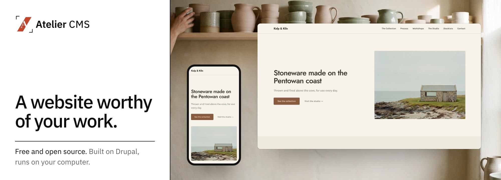

<div align="center">

<picture>
  <source media="(prefers-color-scheme: dark)" srcset=".github/readme/hero-dark.jpg" />
  
</picture>

**Atelier CMS by [AIncient Labs](https://aincient-labs.com)** is a site builder you talk to.
Tell it about your business and it makes the pages, which you can change word by word.
It runs on your computer, and the site, the files and the keys stay with you.

[](LICENSE)
[](https://github.com/aincient-labs/atelier-cms/pkgs/container/atelier-cms)
[](#running-atelier)
[](https://www.drupal.org)

[**Quick start**](#quick-start) · [**See it work**](#see-it-work-in-30-seconds) · [**Publish anywhere**](#publish-your-site-anywhere) · [**Why Atelier**](#why-we-build-this) · [**Whats inside**](#whats-inside) · [**License**](#license)

<br />

<a href="https://aincient-labs.com/#made" title="Watch the recording">
  
</a>

<sub>A request typed into the console becomes a page. <a href="https://aincient-labs.com/#made">Watch the full recording</a></sub>

</div>

---

## Quick start

**The desktop app** is the simplest way in. Download Atelier Manager for macOS, Windows or Linux
from the [latest release](https://github.com/aincient-labs/manager/releases/latest), open it, and
it installs Atelier and starts it for you. It needs [Docker Desktop](https://docs.docker.com/get-docker/)
(free) and your own AI key.

**From a terminal**, the [`atelier` CLI](https://github.com/aincient-labs/manager) does the same
on macOS and Linux:

```bash
brew install aincient-labs/tap/atelier
atelier app install     # pulls the image and starts your site
atelier app open        # opens the console in your browser, signed in
```

`atelier app install` is safe to run twice and keeps everything under `~/.atelier`. First boot
sets up the site by itself, then you land in the console at **`/atelier`** (or open
**http://localhost:41221/** directly).

Everything in this repository is the full product. There is no account to create and no paid tier.
Later, `atelier app update` upgrades in place and rolls back if the upgrade fails, and
`atelier data backup` / `restore` take and restore snapshots of the whole site.

> **No Homebrew, or a headless Docker host?** The one-line installer does the same first run.
> See [Running Atelier](#running-atelier) for that and the manual path.

## See it work in 30 seconds

> **Watch the full demo.** One sentence builds a coffee-roaster site, then
> `atelier site export` ships it to Cloudflare Pages:
> **[Watch on YouTube](https://youtu.be/AJqLBHqNTcM)** ·
> [on the site](https://aincient-labs.com/#made) ·
> [direct MP4](https://aincient-labs.com/assets/video/demo.mp4).

1. **Sign in.** Atelier opens the console at **`/atelier`**.
2. **Connect an AI provider** in the first-run wizard: Anthropic, OpenAI, Google Gemini, Mistral,
   any OpenAI-compatible endpoint, or a local [Ollama](https://ollama.com) server. Atelier checks
   each key with the provider before saving it, and keeps it in the site's own storage, outside
   code and config.
3. **Say what you want:**

   > *"Write a short article about our new Saturday opening hours and save it as a draft."*

   The assistant picks the right tool, creates the content and tells you what it did, in one turn.

From there you carry on in the same chat:

> *"Find the article about opening hours and unpublish it."*
> *"Rename it to Summer hours and publish it."*
> *"Delete it."*

The assistant works under **your** account and permissions, so it can only do what you could do
yourself. Changes that matter wait for your approval.

## Publish your site anywhere

Any site you build can be exported as a **plain static snapshot** and hosted wherever you like,
with no server of your own to run:

```bash
atelier site export --base-url https://your-domain.com
```

`atelier site export` renders your pages to ordinary HTML, CSS and assets, checks every link, and
writes the result to `./aincient-export`. The
**[atelier-deploy-template](https://github.com/aincient-labs/atelier-deploy-template)**
repository is set up to publish that export to **Netlify, Cloudflare Pages, Vercel or GitHub Pages**.
Pick a host with one click, then add your export:

<p>
  <a href="https://app.netlify.com/start/deploy?repository=https://github.com/aincient-labs/atelier-deploy-template"></a>
  &nbsp;
  <a href="https://deploy.workers.cloudflare.com/?url=https://github.com/aincient-labs/atelier-deploy-template"></a>
  &nbsp;
  <a href="https://vercel.com/new/clone?repository-url=https://github.com/aincient-labs/atelier-deploy-template"></a>
</p>

The full walkthrough, including drag-and-drop and GitHub Pages, is in
**[Host your exported site](https://aincient-labs.com/docs/deploy)**.

## Why we build this

**Running a serious website should be as simple as saying what you want.** You should not need to
know what a content type or a view is, especially if you have never used Drupal. Our aim, as far as
a free and open-source project can carry it, is to make Drupal and today's AI models approachable
for the people who run a business.

- **It ships as one product.** Atelier is a versioned container that installs itself, updates
  itself, and rolls back if an upgrade fails.
- **The free version is the whole version.** It is open source and self-hosted, and nothing is
  held back for a paid tier.
- **Drupal underneath, curated on top.** Atelier is built on [Drupal](https://www.drupal.org) and
  shows only the Atelier experience by default. If you know Drupal, the full platform is there
  when you want it. If you don't, you never need to touch it.

> Need support, guarantees or commercial licensing for an organisation? We are happy to talk.
> That work funds the free product and never takes anything out of it.

## Running Atelier

Atelier is distributed as a **versioned public container image**. The image is the product and the
unit of versioning, the way Discourse, GitLab Omnibus and Ghost are delivered. It is published to
GHCR at
[`ghcr.io/aincient-labs/atelier-cms`](https://github.com/aincient-labs/atelier-cms/pkgs/container/atelier-cms)
and can be pulled without a login or token. All paths below run that same image, and the only
prerequisite is [Docker](https://docs.docker.com/get-docker/).

Every published image is **signed with [cosign](https://docs.sigstore.dev/)**. Verification is
optional; the public key is in this repository as [`cosign.pub`](cosign.pub):

```bash
cosign verify --key cosign.pub ghcr.io/aincient-labs/atelier-cms:latest
```

### Option A: Atelier Manager *(recommended)*

The desktop app and the `atelier` CLI come from the same
[Manager repository](https://github.com/aincient-labs/manager) and run the same lifecycle over
Docker. The desktop app is on the
[releases page](https://github.com/aincient-labs/manager/releases/latest) for macOS, Windows and
Linux. The CLI installs with Homebrew on macOS and Linux:

```bash
brew install aincient-labs/tap/atelier
atelier app install
```

| Command | What it does |
| --- | --- |
| `atelier app install` | Set up `~/.atelier`, pull the image, start the stack. Safe to re-run. |
| `atelier app update` | Pull a newer image and converge in place, rolling back on failure. |
| `atelier app status` / `atelier doctor` | Health and Docker-readiness checks. |
| `atelier app start` / `stop` / `open` / `password` | Everyday stack management. |
| `atelier site export` | Export your site to static HTML to host anywhere. |
| `atelier data backup` / `restore` | Portable `.tar.gz` snapshots (database and uploaded files). |
| `atelier ai model list` / `set` | See or change the AI model bound to each role. |

Run `atelier --help` for the full list.

### Option B: one-line installer *(any Docker host)*

Sets up a Docker Compose stack and starts it, with no CLI to install first:

```bash
curl -fsSL https://aincient-labs.com/atelier/install.sh | bash
```

### Option C: Docker Compose by hand

Everything you need is in [`docker/dist/`](docker/dist/):

```bash
cd docker/dist
cp .env.example .env    # set HASH_SALT: openssl rand -hex 32
docker compose up -d
```

Whichever path you pick, first boot installs and configures the site on its own. Open
**http://localhost:41221/** and sign in.

### Upgrading

- **Desktop app or CLI:** **Check for updates** in the app, or `atelier app update`
- **Installer / Compose:** re-run the installer, or `docker compose pull && docker compose up -d`

On every start the appliance **converges**: it snapshots the database, applies pending updates and
configuration, checks its own health, and rolls back if anything fails. Your content, files and
provider keys live in volumes and survive every upgrade.

See [`docker/dist/README.md`](docker/dist/README.md) for the full walkthrough (admin login, ports,
reset) and [`docker/README.md`](docker/README.md) for how convergence works. You can also build the
image yourself from [`docker/Dockerfile`](docker/Dockerfile).

## Requirements

- **[Docker](https://docs.docker.com/get-docker/)** with the Compose plugin (Docker Desktop on a
  laptop). Every path needs it.
- An **API key** for an AI provider, or a local **Ollama** server, connected in the first-run
  wizard. You pay your provider directly for what you use.
- *Optional:* Atelier Manager (desktop app or CLI) for install, updates and backups.

The appliance bundles **PostgreSQL 16** with pgvector, the only supported database.

## What's inside

Atelier is a curated Drupal build: a chosen set of core and contributed modules with locked-down
defaults, rather than a stock Drupal site. The product code lives under `web/modules/custom/`:

| Module | Role |
| --- | --- |
| `aincient_core` | Foundation: shared permissions, the model-role layer, inference adapters, base services. |
| `aincient_chat` | The streaming chat layer: SSE endpoint, agent loop, thread and turn storage, the typed event protocol. |
| `aincient_assistant_ui` | The console (React + [assistant-ui](https://www.assistant-ui.com/)) and its studios. |
| `aincient_pages` | Typed page schemas rendered through single-directory components. |
| `aincient_flows` | [FlowDrop](https://www.drupal.org/project/flowdrop) integration: site capabilities exposed as agent tool nodes. |

Supporting modules cover first-run onboarding, static export, mail, demo content and access
rules, and the front-end themes live under `web/themes/custom/`. *(`aincient` is the internal
namespace; AIncient Labs is the company behind Atelier.)*

## Supported use, and going further

Atelier restricts a lot by default, on purpose: a chosen set of modules, locked-down defaults, one
supported database (PostgreSQL) and one supported way to run it (the appliance). Install it, let it
update itself, and run the site from the console.

If you know Drupal and want more, reaching the full platform underneath is straightforward and
welcome. The complete source is here under the GPL, and anything Drupal can do is a module or a
setting away. Two caveats. We can't support what you build past the defaults, and each upgrade
re-applies the release's configuration, so local changes to shipped config are overwritten by
design.

## Contributing

**Atelier gets better through the people who run it.** You don't need to write code to help:

- **Try it and report what breaks** in the [issue queue](https://github.com/aincient-labs/atelier-cms/issues).
- **Tell us what's missing.** Feature requests and accounts of how you use it shape what ships next.
- **Ask questions.** If something confused you, it will confuse the next person too.

## About this repository

This is the public source home of Atelier. Each release lands as a single snapshot commit made by
our release pipeline, with a plain-language changelog as its message, so the history here follows
*shipped versions* rather than day-to-day development.

## License

- The codebase is **GPL-2.0-or-later** — our grant is in [COPYRIGHT.txt](COPYRIGHT.txt), the full
  GPL version 2 text in [LICENSE](LICENSE). Atelier is free software: built on Drupal and
  distributed under the same license.
- The operator console's React app,
  [`web/modules/custom/aincient_chat/chat-ui/`](web/modules/custom/aincient_chat/chat-ui/), is
  licensed separately under the permissive **MIT license**, because it's browser-side code, not a
  Drupal derivative; see [its LICENSE](web/modules/custom/aincient_chat/chat-ui/LICENSE).
- Custom Atelier modules and themes are © AIncient Labs.

Third-party credits: [ACKNOWLEDGEMENTS.md](ACKNOWLEDGEMENTS.md).

---

<div align="center">

Drupal is a registered trademark of [Dries Buytaert](https://dri.es/).

**[aincient-labs.com](https://aincient-labs.com)** · [Documentation](https://aincient-labs.com/docs) · [Issues](https://github.com/aincient-labs/atelier-cms/issues)

</div>
